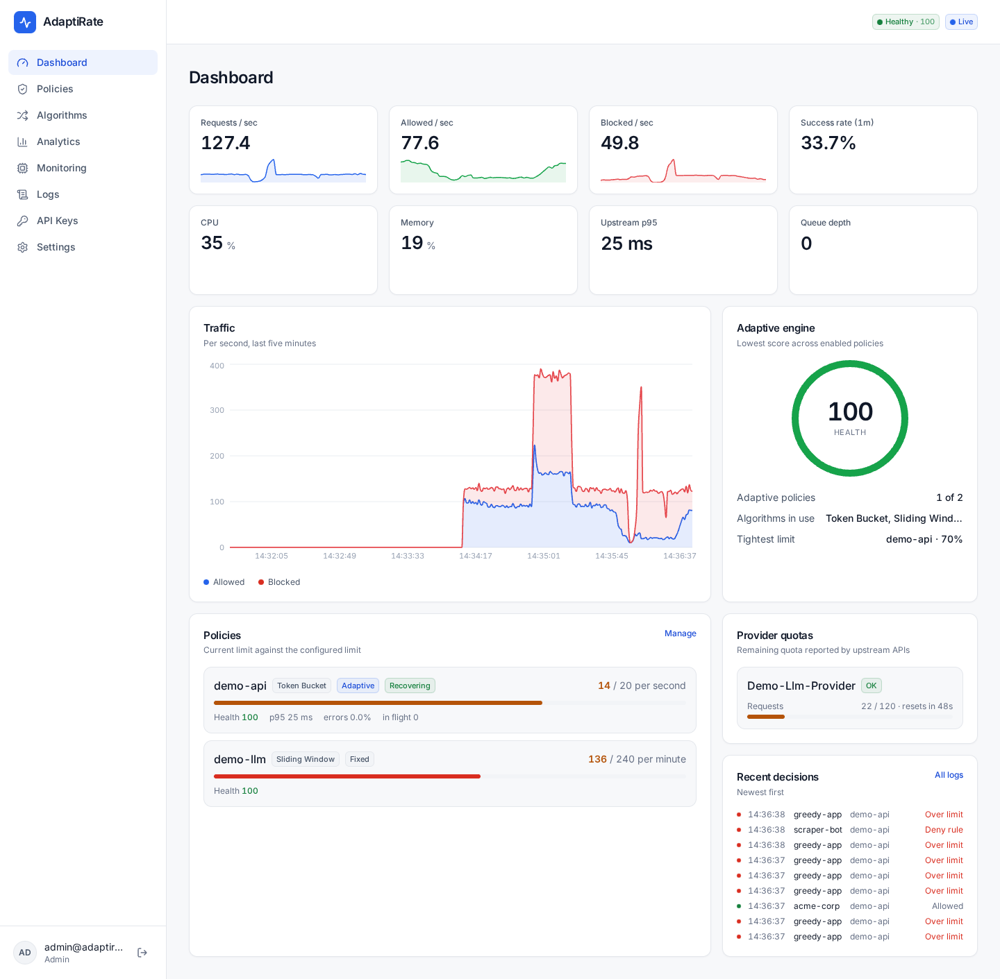
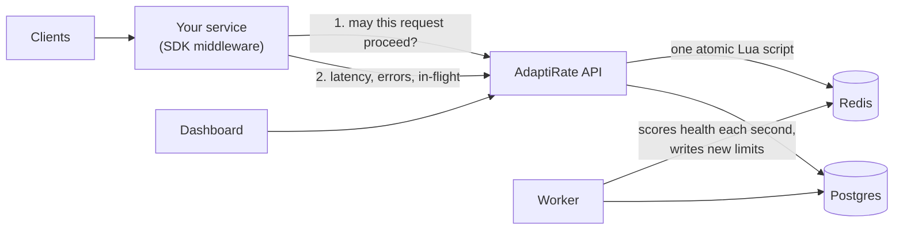

# AdaptiRate

[](https://github.com/Ari-Han-t/AdaptiRate/actions/workflows/ci.yml)

A rate limiter you host yourself, where the limit is not a constant. It is shared across every
process that uses it, it tightens when the service behind it gets slow or starts failing, and it
paces calls to upstream APIs against the quota they report.

I built it because the limiters I had used all enforced a number somebody guessed once. The
number was wrong whenever the service was having a bad day, and it knew nothing about the
OpenAI quota that ten workers were spending at the same time.



Above: the bundled demo just after a simulated slow dependency. While latency was high the limit
for `demo-api` was cut well below its configured 20 per second; here it is back up to 14 and
still climbing. Nobody touched it.

## How it works



Your code names a policy ("checkout") and says who is calling. The limit, the algorithm and any
per-role or per-IP rules live on the server, so changing them is a dashboard edit and not a
deploy. A decision is one Redis round trip and never touches Postgres.

The SDK middleware also reports how each request went. Once a second a worker turns those
reports into a health score per policy and moves the limit: a multiplicative cut when health is
poor, a small additive increase when it is good, nothing in between. For a policy bound to an
upstream provider, the limit is also capped by that provider's remaining quota, and paused
outright when the provider answers 429 with `Retry-After`.

More detail in [docs/architecture.md](docs/architecture.md).

## Try it

```bash
git clone https://github.com/Ari-Han-t/AdaptiRate.git && cd AdaptiRate
cp .env.example .env      # fill in the four values; the file explains each
docker compose up -d
```

The dashboard is at http://localhost:8080. Sign in with the admin email and password you put in
`.env`.

There is a demo you can leave running: a small store API protected by the Python SDK and a
traffic generator that cycles through a spike, a slow dependency and a flaky one.

```bash
docker compose --profile demo up -d --build
```

## Using it in a service

Create a policy in the dashboard (say `checkout`, 100 per minute, per user) and an API key with
the Evaluate and Report permissions. Then:

```bash
export ADAPTIRATE_URL=http://localhost:8080
export ADAPTIRATE_API_KEY=ar_...
```

FastAPI or any ASGI app:

```python
from adaptirate import AsyncAdaptiveLimiter
from adaptirate.asgi import AdaptiRateMiddleware

limiter = AsyncAdaptiveLimiter()
app.add_middleware(AdaptiRateMiddleware, limiter=limiter, policy="checkout")
```

Express:

```js
const { AdaptiveLimiter } = require('@adaptirate/sdk')
const { adaptiveLimiter } = require('@adaptirate/sdk/express')

app.use(adaptiveLimiter({ limiter: new AdaptiveLimiter(), policy: 'checkout' }))
```

Spring Boot:

```java
@RestController
@AdaptiveRateLimit("checkout")
class CheckoutController { ... }
```

Or one call, anywhere:

```python
decision = await limiter.check("send-email", user=user_id)
if not decision.allowed:
    raise HTTPException(429, headers=decision.headers())
```

Over-limit callers get a 429 with `Retry-After` and `X-RateLimit-*` headers. There are fuller
examples for FastAPI, Flask, Django, Express, NestJS and Spring Boot in [examples/](examples).

The SDKs are not on PyPI, npm or Maven Central. Install them from this repository:
`pip install ./sdk-python`, `npm install ./sdk-node`, or `mvn install` in `sdk-java`.

## What is in it

- Five algorithms, switchable on a live policy: token bucket, sliding window, fixed window,
  leaky bucket (GCRA) and a hybrid of token bucket and sliding window.
- Rules on a policy: a different limit for a role, user, IP range or API key, plus allow and
  deny lists.
- Adaptive limits driven by p95 latency, error rate, upstream 429s, queue depth, CPU and memory,
  with a floor and ceiling per policy.
- Provider quota tracking for OpenAI, Anthropic, Groq and GitHub, and a header map for anything
  else.
- Three ways to ask: one request per decision, a batch, or a lease of tokens the SDK spends in
  process.
- A choice of what happens when AdaptiRate is unreachable: allow, deny, or keep enforcing the
  last known limit locally.
- A dashboard with live traffic, policies, analytics, monitoring, a searchable decision log, API
  keys, users and an audit log.
- Admin, developer and viewer roles; API keys that are scoped, expiring and revocable.


## How I know it works

| What | Count | Runs against |
|---|---|---|
| Server tests | 185 | Real Redis and Postgres |
| Python SDK tests | 47 | A fake server and a live one |
| Node SDK tests | 30 | A fake server and a live one |
| Java SDK tests | 32 | A fake server, a Spring MVC app and a live server |
| Acceptance scenarios | 7 | Three real services in containers, real HTTP |

The acceptance suite is the one I would show someone. It starts a FastAPI service as three
replicas, an Express gateway and a fake rate-limited provider, then checks things like: 300
concurrent requests across three replicas let exactly 50 through; a slowed service has its limit
halved within seconds and restored afterwards; a gateway that collected 32 provider rejections
without AdaptiRate collects none with it. Run it with `bash acceptance/run.sh`; details in
[acceptance/](acceptance).

It earned its keep: it found two pacing bugs that the unit tests had missed.

## Performance

A 4-core laptop, the stock `docker compose up` with two API workers, load generator on the same
machine, no failed requests.

| Mode | Throughput | What it costs |
|---|---|---|
| Single check | about 1,450 per second, p99 18 ms | One HTTP call and one Redis round trip each |
| Batch of 100 | about 36,000 per second | One HTTP call per hundred decisions |
| Leased | about 42,500 per second per SDK process | Decided in your process; a limit change takes up to 2 s to reach it |

I set out to reach 50,000 decisions a second. No single mode got there on this machine, and I
have not measured it on server hardware. Method and commands are in [bench/](bench).

## Related work

None of the individual ideas here is new. Shared Redis-backed limits are in nearly every library
and gateway; adaptive concurrency is in Netflix's concurrency-limits, Envoy and Alibaba Sentinel;
AI gateways such as LiteLLM limit calls to model providers. What I could not find in a maintained
open-source project was a shared limit that adapts to service health, or pacing from a
provider's own quota headers before it refuses. The closest, FluxNinja Aperture, has been
dormant since 2024. The survey, with sources, is in [docs/landscape.md](docs/landscape.md).

## Limitations

- One Redis. The Lua scripts build key names at run time, so Redis Cluster is not supported, and
  Redis is a single point of failure. Pick a fail mode with that in mind.
- A check is a network call, a few milliseconds, unless you use leasing.
- The searchable decision log is a sample. Counters and analytics are exact; the log keeps every
  blocked request and one in ten allowed ones by default.
- Host CPU and memory are a poor signal when AdaptiRate runs on a different machine from the
  service it protects. There is a setting to turn that fallback off.
- Provider header formats change. The built-in parsers follow what each provider documents;
  check them against the current documentation.
- It has not run in production anywhere.

## Repository layout

```
adaptirate/     API server and worker (FastAPI, Redis, Postgres)
dashboard/      React dashboard, served by Nginx
sdk-python/     sync and async clients; ASGI, WSGI and Django middleware
sdk-node/       client; Express middleware; NestJS guard and interceptor
sdk-java/       client; Spring Boot starter with @AdaptiveRateLimit
examples/       the same integration in six frameworks, and the demo
acceptance/     end-to-end scenarios against real services
bench/          benchmark method and results
docs/           architecture, API reference, deployment, tuning
```

Further reading: [architecture](docs/architecture.md), [API reference](docs/api.md),
[deployment](docs/deployment.md), [tuning](docs/tuning.md).

## License

[MIT](LICENSE)
