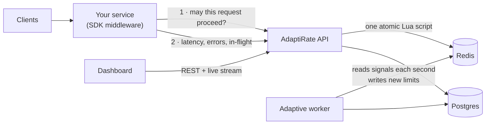
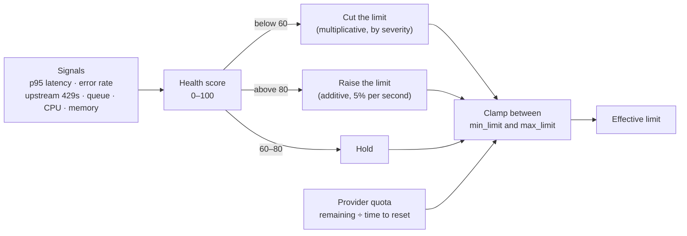
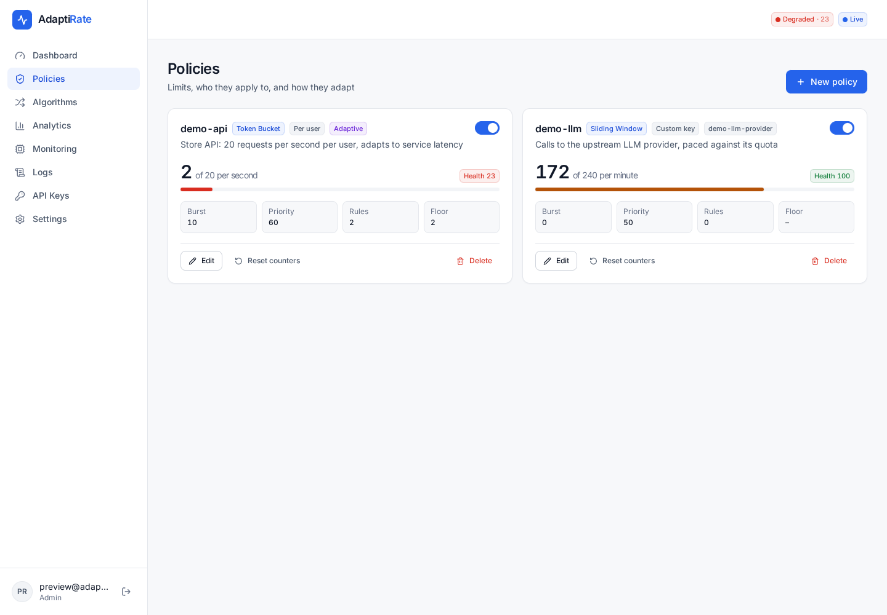
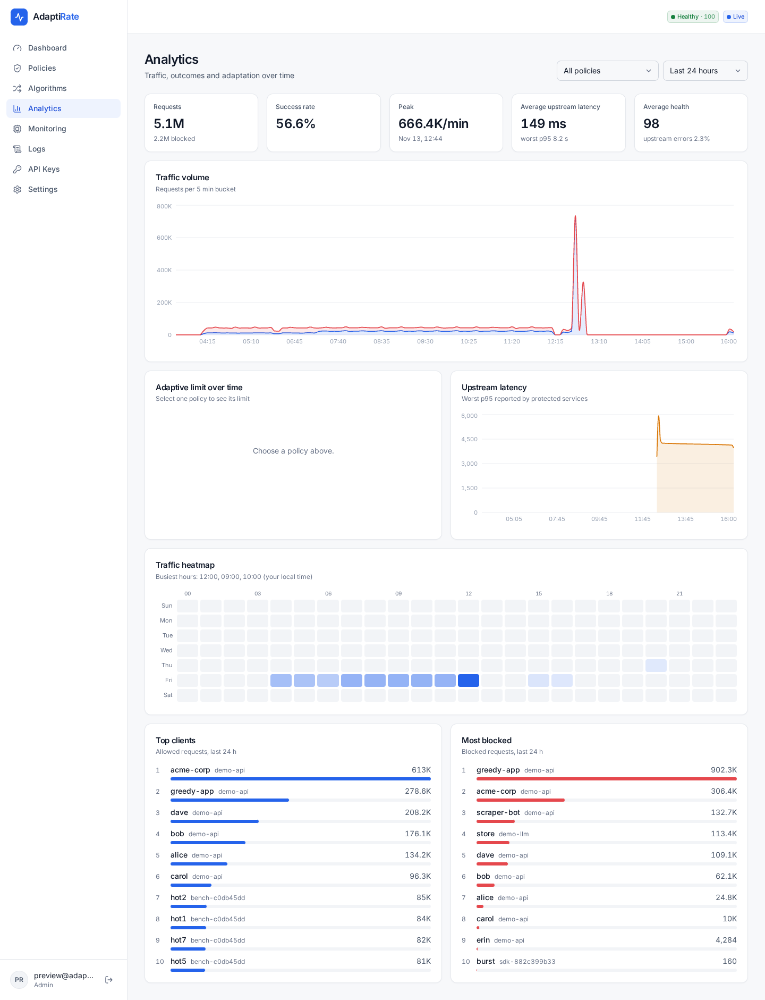
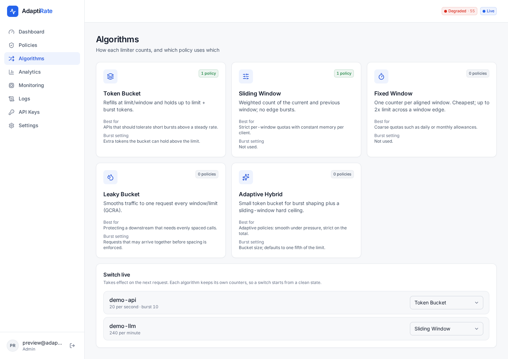
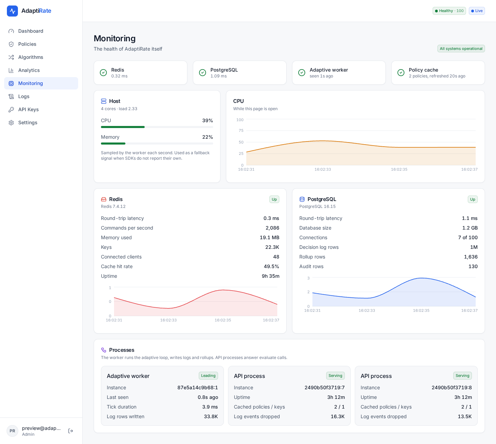
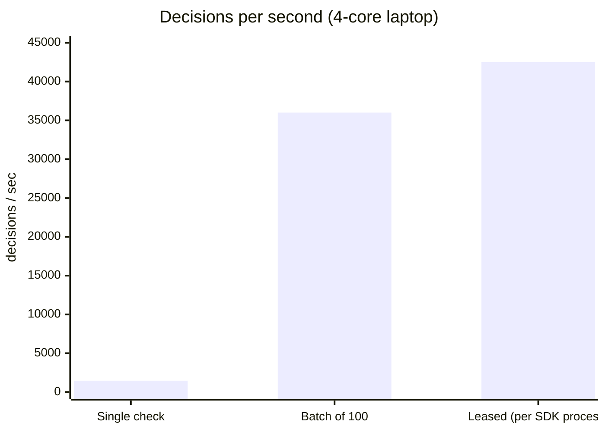

<div align="center">

# AdaptiRate

**A self-hosted rate limiter that adjusts its limits to how your service is actually doing.**

Shared limits across every process · Adapts to latency, errors and provider quotas · Dashboard included

[](https://github.com/Ari-Han-t/AdaptiRate/actions/workflows/ci.yml)


<sub>The dashboard during a simulated slow dependency: latency rose, so the limit for <code>demo-api</code> was cut from 20/s to 2/s.</sub>

</div>

---

## What it does

A normal rate limiter enforces a number you picked in advance. AdaptiRate enforces that number
too, and then moves it:

- **When your service slows down or starts failing**, limits tighten so it can recover, and
  loosen again once it has.
- **When an upstream API (OpenAI, Anthropic, GitHub…) is running out of quota**, calls to it are
  paced across all your workers so you slow down *before* the 429, and pause when one arrives.
- **Limits are shared.** Ten processes on five machines draw from one budget, enforced
  atomically in Redis.

Your code refers to a limit by name. The number, the algorithm and the rules live on the server,
so you change them from the dashboard without a deploy.

## How it works



Every decision is a single Redis round trip that never touches Postgres. A separate worker scores
each policy's health once a second and adjusts its limit:



## Quick start

```bash
git clone https://github.com/Ari-Han-t/AdaptiRate.git && cd AdaptiRate
cp .env.example .env        # then fill in the four values (the file explains each)
docker compose up -d
```

Open **http://localhost:8080** and sign in with the admin email and password from `.env`.

To see it working before you connect anything of your own, start the bundled demo: a small store
API protected by the Python SDK, plus a traffic generator that cycles through a traffic spike, a
slow dependency and a flaky one.

```bash
docker compose --profile demo up -d --build
```

## Add it to a service you already run

1. **Create a policy** in the dashboard (Policies → New policy), for example `checkout`,
   100 per 60 seconds, applied per user.
2. **Create an API key** (API Keys → Generate key) with *Evaluate* and *Report*. It is shown once.
3. **Install the SDK and add one piece of middleware.**

```bash
export ADAPTIRATE_URL=http://localhost:8080
export ADAPTIRATE_API_KEY=ar_...
```

<table>
<tr><th>FastAPI / Starlette</th><th>Express</th></tr>
<tr><td>

```python
from adaptirate import AsyncAdaptiveLimiter
from adaptirate.asgi import AdaptiRateMiddleware

limiter = AsyncAdaptiveLimiter()
app.add_middleware(
    AdaptiRateMiddleware,
    limiter=limiter,
    policy="checkout",
)
```

</td><td>

```js
const { AdaptiveLimiter } = require('@adaptirate/sdk')
const { adaptiveLimiter } = require('@adaptirate/sdk/express')

const limiter = new AdaptiveLimiter()
app.use(adaptiveLimiter({
  limiter,
  policy: 'checkout',
}))
```

</td></tr>
<tr><th>Spring Boot</th><th>Anywhere (one call)</th></tr>
<tr><td>

```java
@RestController
@AdaptiveRateLimit("checkout")
class CheckoutController {
    @PostMapping("/checkout")
    Order checkout() { ... }
}
```

</td><td>

```python
decision = await limiter.check(
    "send-email", user=user_id)
if not decision.allowed:
    raise HTTPException(
        429, headers=decision.headers())
```

</td></tr>
</table>

The middleware answers `429` with `Retry-After` and `X-RateLimit-*` headers when a caller is over
its limit, and reports each request's latency and status, which is what the adaptive engine
feeds on. Full examples for [FastAPI](examples/fastapi), [Flask](examples/flask),
[Django](examples/django), [Express](examples/express), [NestJS](examples/nestjs) and
[Spring Boot](examples/spring-boot) are in [`examples/`](examples).

The SDKs are not published to PyPI, npm or Maven Central yet; install them from this repository
(`pip install ./sdk-python`, `npm install ./sdk-node`, `mvn install` in `sdk-java`).

## Features

| | |
|---|---|
| **Five algorithms**, switchable live | Token bucket, sliding window, fixed window, leaky bucket (GCRA), and an adaptive hybrid |
| **Per-policy rules** | Different limits by role, user, IP range or API key; allow-lists and deny-lists |
| **Adaptive limits** | Driven by latency, error rate, upstream 429s, queue depth, CPU and memory, with a floor and ceiling per policy |
| **Provider quotas** | Reads rate-limit headers from OpenAI, Anthropic, Groq and GitHub, or any API via a custom header map |
| **Three ways to check** | One request per decision, batches, or leased tokens decided inside your process |
| **Fails the way you choose** | Open, closed, or keep enforcing the last known limit locally |
| **Dashboard** | Live traffic, policies, analytics, monitoring, searchable logs with export, API keys, users, audit log |
| **Access control** | Admin, developer and viewer roles; scoped, expiring, revocable API keys |
| **Operations** | Prometheus metrics, health and readiness endpoints, Alembic migrations |

<details>
<summary><b>More screenshots</b></summary>
<br>

| Policies | Analytics |
|---|---|
|  |  |

| Algorithms | Monitoring |
|---|---|
|  |  |

</details>

## Performance

Measured on a 4-core laptop with the stock `docker compose up` (two API workers), load generator
on the same machine, zero failed requests.



| Mode | Throughput | Notes |
|---|---|---|
| Single check | about 1,450/sec, p99 18 ms | One HTTP call and one Redis round trip per decision. Scales with API workers. |
| Batch of 100 | about 36,000/sec | One HTTP call, one Redis pipeline. |
| Leased | about 42,500/sec per SDK process | Decided in your process from a leased block of tokens. |

The original goal for this project was 50,000 decisions per second. **No single mode reached that
on this machine**, and it has not been measured on server hardware. Method and commands are in
[`bench/`](bench).

## Project layout

```
adaptirate/     API server and adaptive worker (FastAPI, Redis, Postgres)
dashboard/      React dashboard, served by Nginx
sdk-python/     Sync and async clients; ASGI, WSGI and Django middleware
sdk-node/       Client; Express middleware; NestJS guard and interceptor
sdk-java/       Client; Spring Boot starter with @AdaptiveRateLimit
examples/       The same integration in six frameworks, plus the runnable demo
bench/          Benchmark script, method and results
docs/           Architecture, API reference, deployment and tuning
```

## Tests

| Component | Tests | What they run against |
|---|---|---|
| Server | 154 | Real Redis and Postgres; includes concurrency tests proving no over-admission |
| Python SDK | 33 | A fake server, plus a live AdaptiRate server |
| Node SDK | 26 | A fake server, plus a live AdaptiRate server |
| Java SDK | 27 | A fake server, a Spring MVC application, plus a live AdaptiRate server |

```bash
docker compose --profile dev run --rm dev pytest        # server
```

CI runs all of the above, plus linting, strict type checking and a migration check.

## Limitations

Worth knowing before you depend on it:

- **Single Redis.** The Lua scripts build key names at run time, so Redis Cluster is not
  supported. Redis is also a single point of failure; choose a fail mode accordingly.
- **Each check is a network call** (a few milliseconds) unless you use leasing, which trades some
  precision for speed: a limit change can take up to two seconds to reach a leasing client.
- **The decision log is a sample.** Counters and analytics are exact; the searchable log keeps
  every blocked request but only a share of allowed ones by default.
- **Host CPU and memory are a weak signal** when AdaptiRate runs on a different machine from the
  service it protects. Turn that fallback off in Settings if so; the SDK-reported signals are the
  ones that matter.
- **Provider header formats change.** The built-in parsers follow each provider's published
  format; verify against their documentation, and use a custom header map if they differ.
- **Young project.** It has not run in production anywhere.

## Documentation

- [Architecture](docs/architecture.md): how decisions, adaptation and storage fit together
- [API reference](docs/api.md): every endpoint (also served live at `/api/v1/docs`)
- [Deployment](docs/deployment.md): configuration, a single EC2 instance, TLS, scaling
- [Tuning](docs/tuning.md): choosing an algorithm and adjusting the adaptive engine

## License

[MIT](LICENSE)
